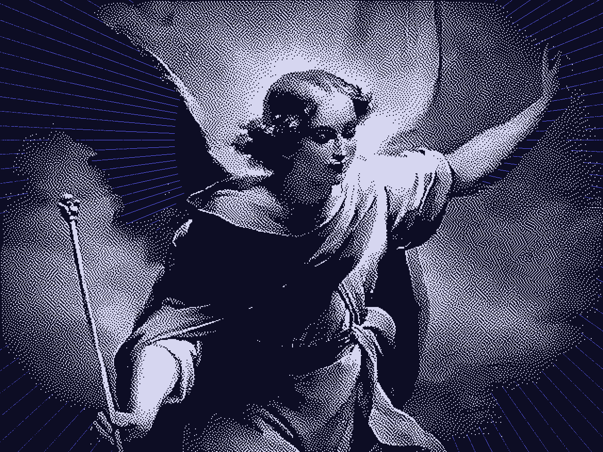
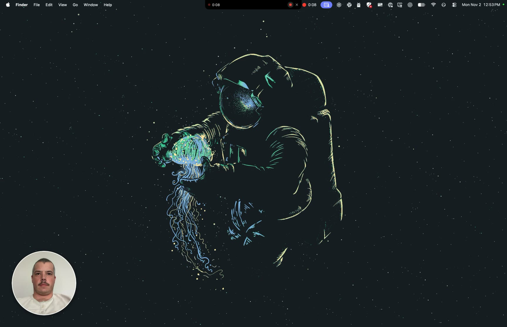
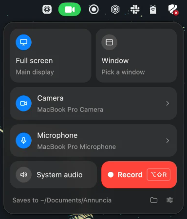

<p align="center">
  
</p>

<h1 align="center">Annuncia</h1>

<p align="center">
  A native macOS screen recorder that lives in your menu bar.<br>
  Record your screen or a single window, talk over it, and keep your face in the corner.
</p>

---



<sub>Recording in progress: timer left of the notch, stop and discard right of it, camera bubble in the corner. The notch controls are left out of the video itself.</sub>

Annuncia is a small, fast alternative to Loom that keeps everything on your Mac. It's written in Rust with [GPUI](https://www.gpui.rs), the UI framework behind the Zed editor, and records through ScreenCaptureKit straight to an MP4 file. There's no account, no upload and no Electron.

The name comes from the Annunciation, where the archangel Gabriel delivers a message on someone else's behalf. *Annuncia* is Latin for "announce": you record something now and someone watches it later.

## Features

- **Lives in the menu bar.** Click the icon for the recorder panel, right-click for quick actions. No Dock icon.
- **Full screen or one window.** Window recordings are cropped to that window. They still include your camera bubble, but not the rest of the desktop.
- **Voiceover and system audio.** Records your microphone, and optionally the sound your Mac is playing.
- **Camera bubble.** A round, mirrored camera overlay you can drag anywhere and hide with a hover button. When the camera is off it shows an avatar image instead. It comes in three sizes, and can let your head pop out over its top edge.
- **Controls around the notch.** While recording, a slim black strip extends the MacBook notch: timer on the left, pause and stop on the right, with restart and discard a hover away. On displays without a notch it's a small capsule under the menu bar. Annuncia's own controls never appear in the video.
- **Global shortcuts.** Start, stop, cancel and toggle the camera from anywhere. Rebind them in Settings.
- **Automatic clean up.** One click (or a setting) trims dead air, shortens long pauses and cuts filler words, as cuts you can see and undo.
- **Trim and cut.** When you stop, an editor opens with a preview and a waveform timeline. Split the recording into clips, drag each clip's handles to trim it (a long pause disappears by splitting inside it and pulling both edges in), and delete clips you don't want. Cuts are frame-exact.
- **Transcripts on your Mac.** Turn on transcription and every recording is transcribed locally, in a second or two, by a speech model running on your Mac's GPU. **Copy transcript** puts it on the clipboard as Markdown, in timestamped paragraphs. Nothing is uploaded.
- **One click to share.** When you stop, the notch drops down with Copy (the file itself, ready to paste into Slack, Mail or Messages), Copy transcript, Edit and Open.
- **Black glass.** Every window shares the notch's black (Liquid Glass under the recorder panel on macOS 26 and later), with blue marking only what's switched on, and a dithered icon to match.
- **Updates itself.** Checks for a new version once a day and installs it when you quit. Turn it off in Settings, or check by hand from the menu bar icon.
- **Plain files.** MP4 (H.264 or HEVC) in a folder you choose, with settings in a JSON file you can edit by hand.

## Requirements

- macOS 15 Sequoia or later. Recording straight to a file and capturing the microphone need ScreenCaptureKit APIs added in macOS 15.
- A recent stable Rust toolchain (the crate uses edition 2024).
- Xcode or just the Command Line Tools (`xcode-select --install`).
- [CMake](https://cmake.org) (`brew install cmake`), which builds the speech engine.

Development and testing have been on Apple Silicon. Intel Macs are untested.

## Build and run

There are no prebuilt releases yet, so build from source:

```bash
git clone https://github.com/thetylerreiff/annuncia.git
cd annuncia
./scripts/bundle.sh
open target/release/Annuncia.app
```

`bundle.sh` builds the binary and wraps it in `Annuncia.app`, with the [Sparkle](https://sparkle-project.org) updater inside (downloaded once into `target/` and checked against its SHA-256). Always run the bundle rather than `cargo run`: macOS only grants camera, microphone and screen access to an app bundle that declares why it needs them.

### Code signing

macOS remembers privacy permissions per code signature. `bundle.sh` signs with the first *Apple Development* or *Developer ID Application* certificate in your keychain, which keeps permissions across rebuilds. To choose one, set `ANNUNCIA_SIGN_IDENTITY` to its name or SHA-1 hash (from `security find-identity -v -p codesigning`).

Without a certificate, the script falls back to ad-hoc signing. That works, but macOS treats every rebuild as a new app, so it asks for permission again and can leave old grants stuck. If that happens, reset Annuncia's grants and relaunch:

```bash
tccutil reset ScreenCapture co.thetylerreiff.Annuncia
tccutil reset Camera co.thetylerreiff.Annuncia
tccutil reset Microphone co.thetylerreiff.Annuncia
```

### Releasing

`scripts/release.sh` publishes the version in `Cargo.toml`: it builds and signs the app with a Developer ID certificate, notarizes it, uploads it to a GitHub release and adds it to the update feed, `site/public/appcast.xml`, which installed copies check once the site deploys. It needs notarization credentials saved once with `xcrun notarytool store-credentials annuncia`, and the Sparkle signing key in the login keychain.

### Permissions

macOS asks for these the first time each one is needed:

| Permission | Needed for |
| --- | --- |
| Screen & System Audio Recording | Every recording. macOS may ask you to quit and reopen Annuncia after granting it. |
| Camera | The camera bubble |
| Microphone | Voiceover |

## Using it



1. Click the menu bar icon to open the recorder panel.
2. Choose **Full screen** or **Window**. Click the round icon on the Camera or Microphone tile to switch it on or off, or the rest of the tile to pick a device. The System audio tile adds the sound your Mac is playing.
3. Press **Record** (or <kbd>Return</kbd>). A short countdown plays in the notch, then recording begins.
4. Pause and resume as often as you like; the timer counts only what's recorded, and the parts are joined into one file without re-encoding.
5. Stop from the notch or with the shortcut. The file is saved, and the notch offers Show in Finder, Copy and Open.

Hover the notch while recording for **Restart** (click twice to confirm) and **Discard**. Both move what you've recorded to the Trash. Nothing is permanently deleted.

<br clear="right">

### Editing

The editor opens as soon as a recording is saved (turn that off in Settings, or reopen it with **Edit** in the notch). Splitting turns the timeline into clips, each with its own trim handles: to drop a pause, split in the middle of it, then drag the end of the left clip and the start of the right clip inward.

| Key | Action |
| --- | --- |
| <kbd>Space</kbd> | Play / pause (cut parts are skipped) |
| <kbd>S</kbd> | Split the clip at the playhead |
| <kbd>⌫</kbd> | Delete the selected clip, or restore it |
| <kbd>C</kbd> | Clean up: trim dead air, shorten long pauses, cut filler words |
| <kbd>I</kbd> / <kbd>O</kbd> | Trim the start / end of the clip under the playhead |
| <kbd>←</kbd> / <kbd>→</kbd> | Step a second (five with <kbd>⇧</kbd>) |
| <kbd>⌘</kbd><kbd>S</kbd> or <kbd>Return</kbd> | Save |

**Clean up** does the tedious part for you: it trims the silence before you start talking and after you finish, shortens any pause longer than a second to a natural beat, and, with an English transcript, cuts "um", "uh" and similar fillers. Each cut is a split with both clips trimmed back, exactly as you'd do it by hand, so dragging a handle restores any of it, and Reset undoes the lot. To have this happen whenever the editor opens, choose **Pauses** or **Pauses and filler words** under **Settings → After recording → Clean up**.

Saving re-encodes the parts you kept, so every cut lands on the exact frame and the file plays the same everywhere. The unedited recording goes to the Trash.

### Transcripts

Choose a language under **Settings → After recording → Transcribe**. The first time, Annuncia downloads the speech model (progress shows in Settings), and from then on every recording is transcribed right after it's saved, including again after you edit it.

| Choice | Model | Download | Notes |
| --- | --- | --- | --- |
| English | NVIDIA Parakeet Unified English 0.6B | 731 MB | Fastest (transcribes minutes of audio in a second or two), with per-word timing |
| Other languages | OpenAI Whisper large-v3-turbo | 886 MB | About 100 languages, detected automatically |

The transcript shows beside the preview in the editor: the current word is highlighted as it plays, clicking a word or a timestamp jumps there, and words in parts you've cut are dimmed. Opening an older recording in the editor transcribes it too.

Models live in `~/Library/Application Support/Annuncia/models`; **Remove** in Settings deletes the one you're using. Transcripts are cached next to them, so reopening a recording doesn't transcribe it again.

### Shortcuts

| Action | Default |
| --- | --- |
| Start / stop recording | <kbd>⌥</kbd><kbd>⇧</kbd><kbd>R</kbd> |
| Pause / resume recording | <kbd>⌥</kbd><kbd>⇧</kbd><kbd>P</kbd> |
| Restart recording | Not set; choose one in Settings |
| Open the recorder panel | <kbd>⌥</kbd><kbd>⇧</kbd><kbd>L</kbd> |
| Toggle the camera (or bring a hidden bubble back) | <kbd>⌥</kbd><kbd>⇧</kbd><kbd>C</kbd> |
| Cancel and discard the recording | <kbd>⌥</kbd><kbd>⇧</kbd><kbd>Esc</kbd> |

To change one, open Settings, click a shortcut and press the new combination. A shortcut must include ⌘, ⌥ or ⌃.

## Configuration

Recordings go to `~/Documents/Annuncia` by default. Settings live in `~/.config/annuncia/settings.json`, or `$XDG_CONFIG_HOME/annuncia/settings.json` if that variable is set. The Settings window covers everything, but the file is plain JSON:

```json
{
  "save_dir": "/Users/you/Documents/Annuncia",
  "capture_mode": "screen",
  "camera_enabled": true,
  "mic_enabled": true,
  "system_audio": false,
  "show_cursor": true,
  "fps": 30,
  "codec": "h264",
  "countdown_secs": 3,
  "bubble_size": "medium",
  "avatar_image": null,
  "hotkeys": {
    "toggle_recording": "alt+shift+KeyR",
    "pause_recording": "alt+shift+KeyP",
    "restart_recording": "",
    "open_launcher": "alt+shift+KeyL",
    "toggle_camera": "alt+shift+KeyC",
    "cancel_recording": "alt+shift+Escape"
  }
}
```

Shortcuts use the [`global-hotkey`](https://crates.io/crates/global-hotkey) format: modifiers joined with `+`, then a key code such as `KeyR`, `Digit1` or `F5`.

## How it works

| Area | File | Approach |
| --- | --- | --- |
| Capture | `src/recorder.rs` | An `SCStream` with an `SCRecordingOutput` that writes the MP4, video and both audio tracks together, so Annuncia never handles a frame. |
| Window mode | `src/recorder.rs` | Records the display, keeping only the target window and the camera bubble, then crops to the window with `sourceRect`. A plain single-window filter would leave out the bubble. |
| Pause and resume | `src/recorder.rs`, `src/media.rs` | Pausing detaches the recording output, finishing a part, while the stream keeps running. On stop the parts are joined with AVFoundation without re-encoding. |
| Transcription | `src/transcriber.rs`, `src/models.rs`, `src/speech.rs`, `src/transcript.rs` | [transcribe.cpp](https://github.com/handy-computer/transcribe.cpp) runs GGUF speech models on Metal. Audio is mixed to 16 kHz mono with an `AVAssetReader`, cut into chunks of up to 30 seconds at real pauses (found from the audio's energy against an adaptive noise floor), and transcribed on a worker thread that keeps the model loaded between recordings. Model files are pinned to a revision and verified by size and SHA-256. |
| Editor | `src/ui/editor.rs`, `src/edit.rs`, `src/player.rs` | `AVPlayer` plays the file and an `AVPlayerItemVideoOutput` feeds its frames to `surface()`. The waveform comes from an `AVAssetReader`. Saving builds an `AVMutableComposition` from the kept ranges and re-encodes it through a video composition. |
| Pop-out bubble | `src/popout.rs` | Vision's person segmentation separates you from your background on each camera frame; Core Image composites the background in the circle, the ring, and you on top (free to rise above the circle, never out of its sides) into a transparent frame shown on a native layer under the bubble's view. |
| Camera | `src/camera.rs` | An `AVCaptureSession` delivers NV12 frames that go straight into GPUI's `surface()` element, with no copying or conversion. |
| Controller | `src/app.rs` | One GPUI entity owns the recording state and keeps the windows, camera and menu bar icon in sync with it. |
| Updates | `src/updater.rs`, `scripts/release.sh` | [Sparkle](https://sparkle-project.org), loaded from the bundle at runtime. Updates are EdDSA-signed zips on GitHub Releases, listed in a feed on the website. |
| Menu bar and shortcuts | `src/tray.rs`, `src/hotkeys.rs` | [`tray-icon`](https://crates.io/crates/tray-icon) and [`global-hotkey`](https://crates.io/crates/global-hotkey), read from a GPUI task. |
| Native windows | `src/native.rs` | AppKit through `objc2`: non-activating panels, window levels above the menu bar, notch size from the screen's safe area, and Liquid Glass. |
| UI | `src/ui/` | The notch HUD, camera bubble, recorder panel and Settings window, all in GPUI. |

`build.rs` lets the project build with only the Command Line Tools. It points the linker at their Swift runtime, which the ScreenCaptureKit bindings need, and GPUI compiles its Metal shaders at runtime, so the Xcode Metal compiler isn't required.

## Roadmap

These aren't built yet:

- Recording a selected region
- Following a window that moves during a window recording
- A display picker (today it records the main display)
- Optional upload to cloud storage for share links

Issues and pull requests are welcome. Before sending a change, run `cargo fmt` and `cargo clippy`, and test the bundled app with `./scripts/bundle.sh`.

## Credits

- The header image is a painting of the archangel Gabriel, rendered with Atkinson dithering, the 1-bit technique Bill Atkinson created for the original Macintosh.
- Speech recognition runs on [transcribe.cpp](https://github.com/handy-computer/transcribe.cpp) (MIT). The models are downloaded from Hugging Face, not bundled: [Parakeet Unified English](https://huggingface.co/handy-computer/parakeet-unified-en-0.6b-gguf) is under the NVIDIA Open Model License, and [Whisper large-v3-turbo](https://huggingface.co/handy-computer/whisper-large-v3-turbo-gguf) is MIT.
- Updates through [Sparkle](https://sparkle-project.org) (MIT).
- Built on [GPUI](https://github.com/zed-industries/zed/tree/main/crates/gpui), [screencapturekit-rs](https://github.com/doom-fish/screencapturekit-rs), [objc2](https://github.com/madsmtm/objc2), [tray-icon](https://github.com/tauri-apps/tray-icon) and [global-hotkey](https://github.com/tauri-apps/global-hotkey).

## License

MIT. See [LICENSE](LICENSE).
